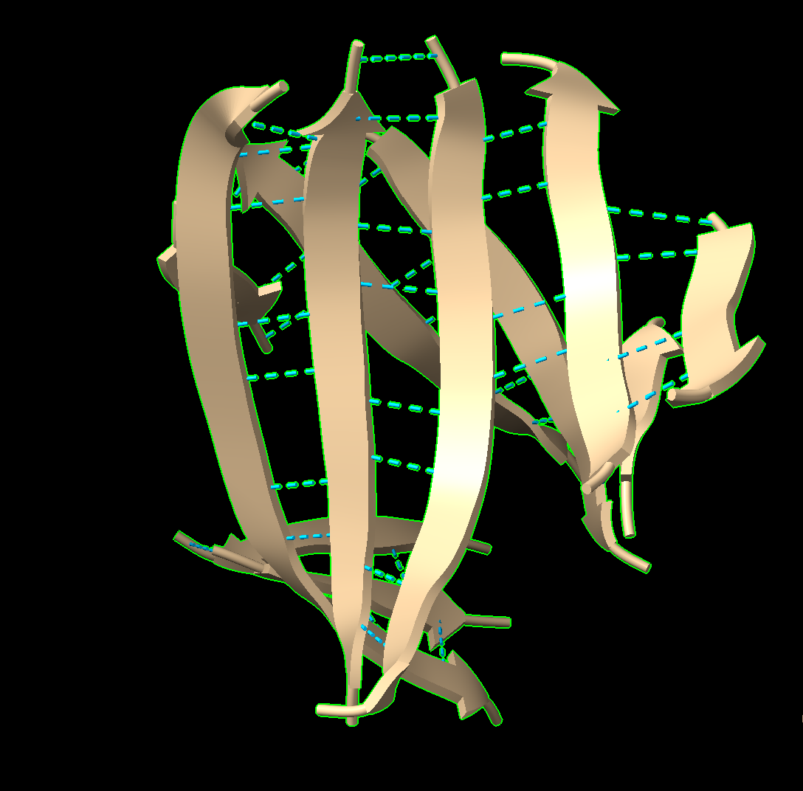

**Scientist’s Mission (A12345678, 鄒文雄)**  
[GitHub - paristzou/angel: 1011 · GitHub](https://github.com/paristzou/angel)

**Who Stole TP53’s Superpower? Searching for the Key to Unlock Cancer**

**Using AI to Uncover the Secrets of TP53–DNA Interactions**

**1. 【The LEGO Assembly Line】**

What type of bond links amino acids together to form a protein? Which amino acids form hydrogen bonds with each other?

**Answer:**

**2. 【The Double-Track Highway of Life’s Blueprint】**

How do nucleotides assemble to form double-stranded DNA? What are the basic structural components of DNA? Is DNA right-handed or left-handed? List the names of the four DNA bases. Which bases form hydrogen bonds with each other?

**Answer:**

**3. 【Searching for My One-and-Only Soulmate in the Universe: A 20-Base-Pair Love Code Hidden Among 3 Billion DNA Base Pairs】**

**The source of molecular stability and specificity: hydrogen bonding — How do TP53 and DNA recognize each other?**

Using the structure **3KMD**, identify one pair of an **amino acid and a DNA base** that interact with each other.

**Answer:**

**4. 【Return to the Crime Scene】**

Why can a mutation (change) in just **one amino acid** of a protein sometimes lead to a serious human disease? Give one specific example of such a disease.

**Answer:**

**5. 【Return to the Crime Scene: Searching for Clues】**

Using the TP53–DNA structure (**3KMD**), identify **one TP53 amino acid mutation** that can lead to uncontrolled cell division and contribute to the development of cancer.

Then examine this amino acid in **ChimeraX**. Based on its three-dimensional position, determine whether the mutated amino acid is located directly at the **protein–DNA interface** or somewhere else in the protein.

**Answer:**

a. Paste a screenshot of your ChimeraX visualization here.

b. Save your ChimeraX session file as **StudentID.cxs**.
